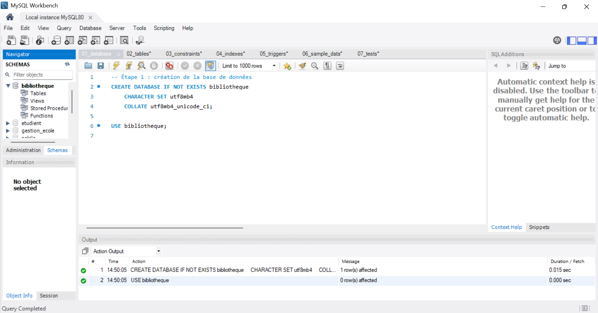
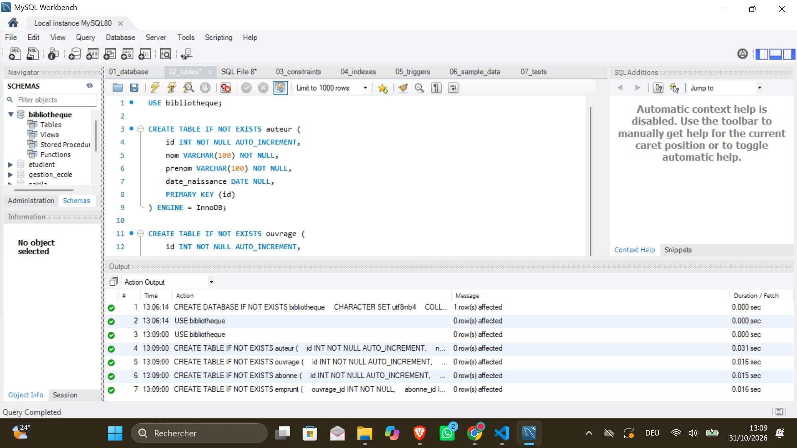
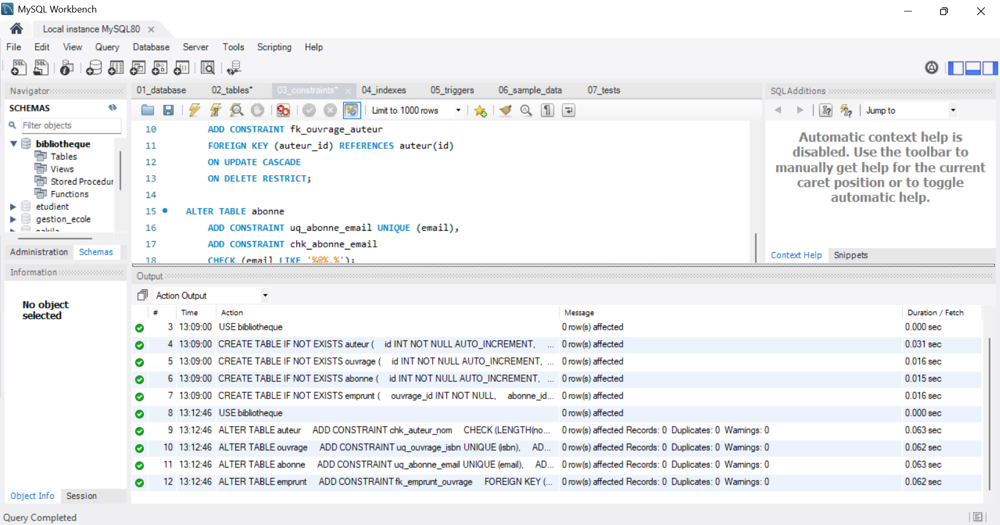
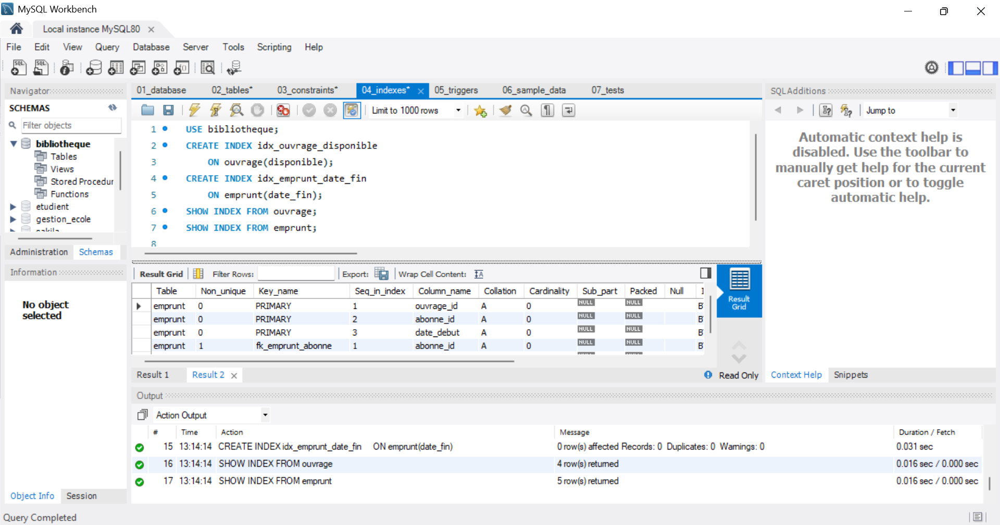
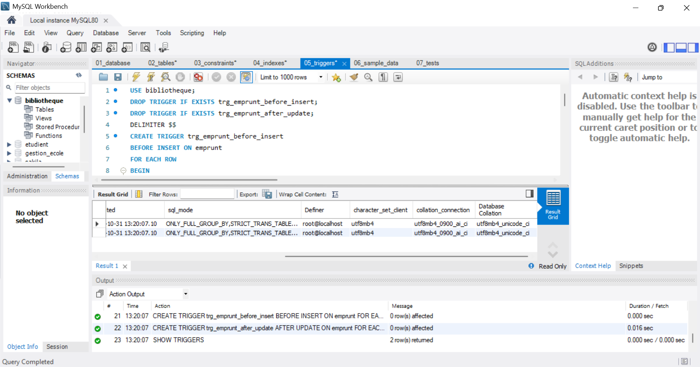
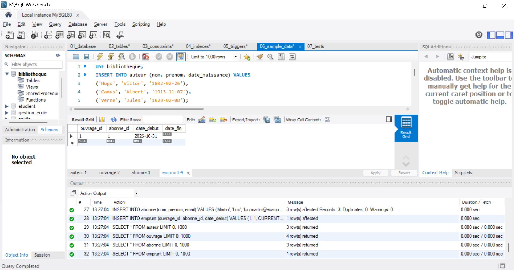
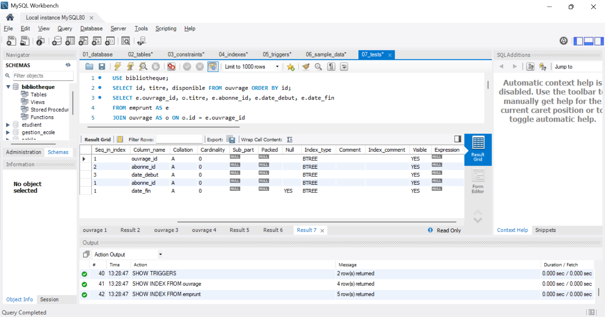

Fichiers SQL
Les scripts SQL sont disponibles dans le dossier `sql`.
Les fichiers sont organisés selon l'ordre d'exécution :
1. Création de la base de données.
2. Création des tables.
3. Contraintes d'intégrité.
4. Création des index.
5. Création des triggers.
6. Insertion des données.
7. Tests SQL.

Captures d'écran de l'exécution

1. Création de la base de données

2. Création des tables

3. Contraintes d'intégrité

4. Création des index

5. Création des triggers

6. Insertion des données

7. Tests SQL

Fichier Schema

Le fichier "lab2_schema.sql" permet de créer toute la structure de la base de données en une seule exécution.

Il contient :

- La création de la base de données.
- La création des quatre tables.
- Les clés primaires et étrangères.
- Les contraintes.
- Les index.
- Les triggers.
[📄 Consulter le fichier lab2_schema.sql](https://github.com/aizili3449/DB_LAB2/blob/main/DB_LAB2_Bibliotheque/sql/lab2_schema.sql)

Fichiers SQL

1. Schema complet

"📄 lab2_schema.sql" (sql/lab2_schema.sql)

Ce fichier permet de créer toute la structure de la base de données en une seule exécution.

2. Scripts détaillés

Fichier| Description
"01_database.sql" (sql/01_database.sql)| Création de la base de données
"02_tables.sql" (sql/02_tables.sql)| Création des tables
"03_constraints.sql" (sql/03_constraints.sql)| Ajout des contraintes
"04_indexes.sql" (sql/04_indexes.sql)| Création des index
"05_triggers.sql" (sql/05_triggers.sql)| Création des triggers
"06_sample_data.sql" (sql/06_sample_data.sql)| Insertion des données de test
"07_tests.sql" (sql/07_tests.sql)| Tests de la base de données

Remarque : Le fichier "lab2_schema.sql" regroupe la structure complète de la base de données. Les scripts détaillés permettent de consulter et d'exécuter chaque étape séparément.
